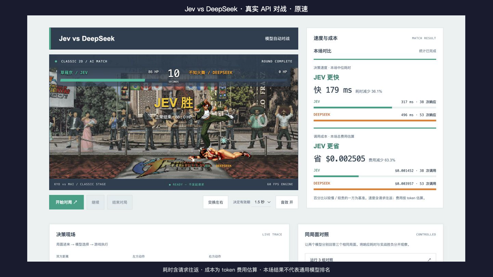

# Decision Arena

本地 Jev 对 DeepSeek 自动格斗 Demo，使用草薙京、不知火舞的经典二维角色画面和拳皇舞台，战斗规则为独立简化实现。两个模型接收相同格式的游戏状态、合法动作和招式规则，通过真实 API 作出决策。游戏引擎持续运行并执行动作。

## 看一场真实实测

[](docs/media/jev-vs-deepseek-demo.mp4)

**[观看／下载 1080p 完整录屏](https://github.com/code-cheers/jev-fighting-demo/raw/refs/heads/main/docs/media/jev-vs-deepseek-demo.mp4)** · 56 秒 · 原速 · 无音轨。视频前两秒为待机，随后点击开始，比赛画面与右侧实时数据全程同屏，末尾保留最终结算。

2026-10-12 本次录屏结果（Jev `jev-1.13.0`；DeepSeek `deepseek-flash`，关闭思考）：

| 指标 | Jev | DeepSeek | 本场对比 |
|---|---:|---:|---|
| 决策到可执行中位耗时 | 317 ms | 496 ms | Jev 快 179 ms，耗时减少 36.1% |
| 整场费用估算 | $0.001452 | $0.003957 | Jev 省 $0.002505，费用减少 63.3% |
| 调用数 | 38 | 53 | 双方独立决策，调用数可能不同 |
| 剩余血量 | 86 HP | 0 HP | Jev 获胜 |

这次录屏 Jev 更快、更省且获胜。[前一次录制的测量](docs/earlier-measurement.json)中 Jev 同样更快、更省，但 DeepSeek 获胜；前一次因结算画面裁切不完整而重录。动作选择与时机也影响胜负，不能把胜负完全归因于响应速度。速度含浏览器往返和调度；费用按响应 token 与当时单价估算，最终以服务商账单为准。百分比以较慢／较贵的一方为基准。这是一场演示，不能作为通用能力或胜率排名。

[本场测量与录制信息](docs/demo-result.json)。录制准备与导出使用 [desktop-recorder](https://github.com/code-cheers/jev-fighting-demo/blob/main/docs/recording.md) 工作流；原生捕获不可用时，改为按真实时间戳采集浏览器页面帧。

## 启动

需要 Node.js 22。HTTP 传输使用 Undici，并遵循本机代理环境配置。

```sh
npm install
npm start
```

打开 http://127.0.0.1:8878 。已有密钥存放在 `.env.local`，不会提供给浏览器或被 Git 提交。新机器可复制 `.env.example` 并自行填写。

仅保留 Jev vs DeepSeek 自动对战；两个模型自主选择动作，可交换左右位置。每局 45 秒，每局最多 120 次付费调用。**页面初始不调用模型；点击开始对局或同局面对照后才付费调用。** 切换后台自动暂停，返回前台自动继续；手动暂停和接口报错不会自动恢复。

## 实验规则

- Jev 默认 `jev-1.13.0`；DeepSeek 默认 `deepseek-flash`，显式关闭思考模式，输出最多 32 token 的动作 JSON。名称可以通过本地配置覆盖。
- 同一能力、状态信息、动作集合、有效期和执行规则。不为任一模型提供隐藏战斗脚本或自动防守。
- 可交换左右位置；同帧攻击同时结算，避免左方处理顺序优先。
- 每个模型最多每秒 2 次请求，最多一个在途请求。若角色正在攻击或受击且只有等待可选，则不调用模型。
- 决策有效期默认 1.5 秒。迟到、暂停期间返回、当前已不能执行以及无效输出均记入“未执行”；不自动重试或替模型挑另一招。
- 暂停与结束停止新请求，已经发出的请求仍可能产生费用。最终计费以服务商账单为准；网络失败可能已在上游执行，界面无法精确核对这种费用。
- 实战面板耗时从浏览器发起请求到决定可执行，包含请求往返和调度；服务端日志同时保留原始 API 耗时。不是官方推理延迟。
- 同局面对照为三个固定场景，每个模型各回答一次，共 6 次调用，单独记录，不计入游戏统计。
- 费用使用响应 token 与公开单价估算：Jev 输入 $0.042/M，输出免费；DeepSeek Flash 分缓存命中、未命中与输出，按 UTC 工作日高峰时段判断半价。中国法定假日未自动识别，因此假日期间估算可能偏高。
- 游戏胜负不是模型通用能力或准确率排名。不要根据单次或少量调用预设 Jev 更快、更准或必胜。
- 服务端原始决策日志在被忽略的 `runs/`，包含局面、动作、API 耗时与 token 费用估算。

## 验证

```sh
npm test
npm run verify
```

测试无需 API。`verify` 对每个服务做一次真实付费调用，输出不含密钥。服务只绑定本机回环地址，采用来源检查和页面令牌。仅显式允许的静态文件可下载；环境配置不能通过 HTTP 读取。

## 参考

- [Jev 街霸实验](https://github.com/smartaces/jev-plays-streetfighter-2)
- [LLM Colosseum](https://github.com/OpenGenerativeAI/llm-colosseum)
- [TypeSafe HTTP API](https://docs.typesafe.ai/api)
- [TypeSafe 模型与定价](https://docs.typesafe.ai/models)
- [DeepSeek 定价](https://api-docs.deepseek.com/quick_start/pricing/)

本项目采用独立简化规则，不包含游戏 ROM；角色和舞台素材的来源与归属见下文。

### 经典二维画面

草薙京和不知火舞使用逐帧角色动画，舞台含观众动画。角色呈现与控制模型分开：交换左右会交换模型控制方，战斗参数仍相同。当前规则为独立简化规则，并非完整拳皇引擎。防守使用保持的蹲姿与防守效果。素材来源、版本与归属见 `public/assets/kof/SOURCES.md`；来源公开不等同于商业素材授权。原始素材打包脚本为 `scripts/pack-kof-assets.py`，用 Pillow 将 GIF 帧保存到透明 PNG 图集。

### 请求调度与暂停

本地服务按模型分别串行调度，两次实际调用开始至少相隔 500 毫秒；稍早到达的请求等待后执行，避免浏览器与服务端计时边界造成误限流。暂停时舞台状态显示暂停原因；已经因错误暂停时，切到后台不会覆盖错误提示。明确未调用模型的本地拒绝不添加未知费用标记。更新或重启本地服务后，请刷新旧页面并开始新局。

## 对局结束后的速度与成本对比

结束后在右侧顶部显示本场较快／较省的模型、双方数值、绝对差额和百分比。速度使用所有成功响应的“决策到可执行”中位耗时，成本使用本场总费用估算；百分比以较慢／较贵的一方为基准。双方调用数量可能不同，面板同时展示响应样本数与调用次数。

在途请求完成后自动更新结果；无响应样本、未知费用和零调用不强行判定胜者。平局显示相同。页面显示统计是否完成。

桌面布局左侧为舞台与控制，右侧顶部为速度与成本；结束后同区域替换为本场结论，决策现场和同局面对照位于整个对战区域下方，实验边界位于页面底部。窄屏改为上下排列。
